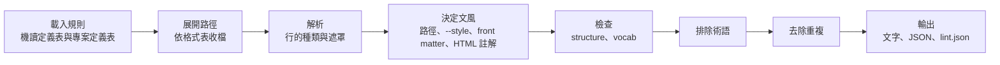

# 引擎準則

`scripts/writing/` 引擎的演算法約定：管線、解析與遮罩、路徑設定與文風、層級的決定、各檢查的範圍、詞表比對、術語與重複的發現項目。模組與介面見 [scripts-contract](../scripts-contract.md)，各表的欄位見 [tables-catalog](../tables-catalog.md)。

## 管線

一次執行依下圖前進。載入規則時讀取全部機讀定義表並檢查表與表之間的指向，之後每份文件依序解析、決定文風、執行各檢查，最後彙整全部文件的發現項目：

## 解析與遮罩

格式依副檔名決定。markdown 與 mdx 依 markdown 解析，每一行判定為標題、表格、清單、圖、引言、段落、區塊或標記。front matter、code fence、圖表區塊（`::: mermaid` 這類）與 HTML 註解區塊內的行不是正文。mdx 的 import 與 export 行是標記。純文字的非空行都是段落。

正文的行遮罩後才檢查。遮罩與原文等長，命中的欄號與文字都對應原行。遮罩的範圍：

- 行內 code：開頭與結尾的反引號數相同，遮罩成 U+0001。正規式要把行內 code 當成英文字時寫 `\x01`
- HTML 註解、連結網址、HTML 標籤與 mdx 的大括號運算式：遮罩成 U+0000
- 引用括號內的文字：括號保留，內容遮罩成 U+0000
- 引言前綴：換成等長的空白
- 詞表比對時另外遮罩網址

## 路徑設定與文風

路徑設定表依路徑樣式給出 Wiki 版面與文風。skill 只提供預設列「**」，各路徑的設定由專案定義表整張取代。路徑相對於 `--root`，一個檔案符合多個樣式時取最長的樣式，「**」是預設。`--text` 的文字不比對路徑。

HTML 註解宣告的文風從宣告的位置起，套用到下一個同級以上的標題或 `<!-- writing-style: end -->`，同級指宣告所在章節的標題層級。文風可以寫多個，以逗號或頓號分隔，依序套用。一份文件套用的文風依下列順序決定，後者取代前者：

1. 路徑設定表給的文風
2. 命令列的 `--style`
3. front matter 的 `writing-style:`
4. HTML 註解 `<!-- writing-style: 文風 -->`

## 層級的決定

一筆發現項目的層級依下列順序計算。算出的層級輸出為否時不記錄，規則的範圍是 markdown 而文件是純文字，或範圍是 Wiki 版面而文件不採 Wiki 版面時，同樣不記錄：

1. 規則表的預設層級
2. 這一行的每個文風依序覆寫：文風覆寫表指名這條規則的列優先，沒有時取規則寫「全部」的列
3. `--off` 關閉的規則改成輸出為否的層級

## 檢查範圍

各檢查套用的行與範圍如下：

| 檢查 | 模組 | 範圍 |
|---|---|---|
| Wiki 版面：TOC、標題層級、H1 與 H2 分隔、標題深度、H2 的語言、`.order` | `structure` | 採 Wiki 版面的 markdown 檔。TOC 標記要在第一個標題之前 |
| code block 語言、句中粗體、產物之後的補述 | `structure` | markdown 與 mdx。句中粗體略過區塊開頭的粗體、單獨一行的粗體與加重語氣區塊內的粗體 |
| 正規式 | `vocab` | 依比對對象：遮罩行是標題、段落、引言、清單與表格列，表格以外略過表格列，段落與清單只看段落、引言與清單。每一列在一行只列出第一個不在例外的命中 |
| 詞表 | `vocab` | 區塊：一個段落或引言的連續行、一個清單項、一個表格列或一個標題 |
| 成對連接詞 | `vocab` | 一個段落，或項與項之間沒有空行的一份清單。開頭詞之後沒有任何接續詞時列出開頭詞 |

## 詞表比對

不使用寫法、技術用語對照中有大陸寫法與規則的列、英文詞表的全部列合成一份詞表，依寫法長度由長到短排列。比對時由左到右掃描，每個位置取最長的詞，命中後跳過整個詞：

- 英文詞不分大小寫並比對完整單字。前一字是英文字、數字、連字元、句點或斜線時不算，後一字是英文字、數字，或連字元、句點、斜線再接英文字時也不算，網域、路徑與連字名稱的一段就不會命中。
- 中文詞的前一字與第一字，或最後一字與後一字，組成邊界詞表的詞時不算命中，例如「修改檔案」的「改檔」。
- 例外欄的整詞包住命中時不算命中，例如「落地頁」的「落地」。
- 英文詞表的列只在寫法與表內不同時列為專有名詞大小寫，例如「github」。
- 同一條規則在區塊內的命中數達成群門檻時，逐一列出。

## 術語與重複的發現項目

中英夾雜的片語登記在英文詞表，或在同一次檢查中出現的文件數達門檻表的「術語檔案數」時視為術語，不列出。同一行、同一條目與同一命中文字的發現項目只留層級順位最高的一筆，例如同一個「；」同時符合「中文分號黏接」與「中文分號」時只列為前者。
