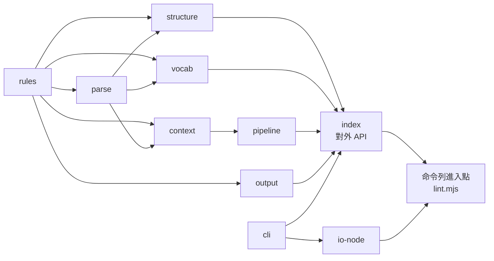
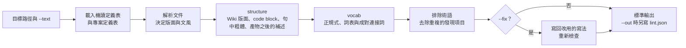

# 寫作檢查腳本契約

本檔定義 `scripts/` 的引擎模組、對外 API、命令列進入點、輸入輸出格式、結束代碼，以及程式與 skill 文件的撰寫要求。引擎是一份 JS 實作，核心模組經由 io 介面存取檔案。規則寫在機讀定義表，引擎依表執行：解析與遮罩文件、決定文風與層級、檢查版面、格式與詞彙，每筆發現項目附判定問題、改法與參照。管線、遮罩與比對等演算法見 [design/engine](design/engine.md)。

## 適用範圍

Skill `/rule-writing` 與呼叫它的 skill 依本檔呼叫命令列進入點。其他工具依本檔引用引擎 API。實作可以演進，介面改動時同步更新本檔。

## 模組

引擎模組放在 `scripts/writing/`，以檢查的層切分，一個模組一個 `.mjs`。引擎以外的程式放在 `scripts/`：命令列進入點只組合模組，決定要執行的檢查，把各檢查模組匯出的 `RULES` 傳給 `Context`。引擎模組：

| 模組 | 層 | 責任 |
|---|---|---|
| `base` | 底層 | 共用常數、錯誤與結束要求、字串與路徑工具、機讀定義表的檔名與表頭、TSV 解析、專案定義表的合併與發現項目 |
| `rules` | 規則 | 讀取全部機讀定義表，檢查格子值與表與表之間的指向，組出規則、層級、判定、文風、門檻、正規式、成對連接詞、路徑設定、格式、詞表與 markdown 寫法 |
| `parse` | 解析 | 行的種類、等長遮罩、詞表的區塊與成對連接詞的範圍 |
| `context` | 底層 | 一次執行的規則、文風與發現項目。解析文件、依路徑設定與文風宣告決定每一行的文風，依文風與 `--off` 決定層級，依規則表記錄發現項目 |
| `structure` | 檢查：版面與格式 | Wiki 版面（TOC、標題層級、H1 與 H2 分隔、標題深度、H2 的語言、`.order`）、code block 語言、句中粗體與產物之後的補述 |
| `vocab` | 檢查：詞彙 | 正規式、詞表（不使用寫法、技術用語、英文詞的寫法）與成對連接詞 |
| `pipeline` | 流程 | 展開路徑、讀取文件、依序執行傳入的檢查、排除術語、去除重複的發現項目與自動取代 |
| `output` | 輸出 | 文字與 JSON、`lint.json` 的內容、判定檢查與標準答案集的比對 |
| `cli` | 底層 | 進入點的命令列解析、選項表、說明文字與專案輸入的建立 |
| `io-node` | 執行環境 | io 介面的 node 實作與進入點的執行包裝（指令行、結束代碼與執行紀錄），只有本模組與進入點 import `node:*` |
| `index` | 對外 API | 重新匯出核心模組，檢查模組以模組名稱作為命名空間匯出 |

模組之間的相依如下圖，箭頭由被匯入的模組指向匯入它的模組。全部模組都匯入 `base`，圖中省略 `base` 的箭頭。`index` 重新匯出全部模組，圖中只畫沒有被其他模組匯入的模組接到 `index`：



## 通用約定

- Node 20 以上，ES module，沒有第三方相依。
- 核心模組不 import `node:*`，檔案與標準輸出入經由 io 物件，瀏覽器與測試才能用同一份模組。核心模組不結束行程：需要以結束代碼結束時丟出 `ExitRequest`，由進入點的 `runMain` 寫出訊息並設定結束代碼。
- 檢查範圍是傳入的路徑。傳入的目錄遞迴掃描格式表 `layout-formats.tsv` 登記副檔名的檔案，`node_modules`、名稱以「.」開頭的子目錄與含 `expected.tsv` 的子目錄略過。
- `--root` 是呼叫者指定的基準目錄，顯示的路徑與路徑設定表的路徑樣式都相對於它，沒有指定時為工作目錄。
- 專案輸入：`--project`（專案定義表：與機讀定義表同表頭的 TSV，或含專案定義表的目錄，可以重複指定）。沒有傳入時只用 skill 的機讀定義表。專案要傳入哪些檔，由各儲存庫根目錄的 `AGENTS.md` 說明。
- 機讀定義表的文字、專案輸入、程式判定的規則名稱、`--style` 與 `--off` 都由進入點傳入 `Context`，引擎不自行讀取命令列。
- 預設輸出人類可讀的行，第一行是本次執行的指令，倒數第二行是摘要，最後一行是結束代碼。`--json` 輸出單一 JSON 物件，`command` 欄位標明來源。錯誤摘要寫 stderr，stdout 維持可解析。
- 執行紀錄：指定 `--out` 或 `--judged` 的目錄時，本次執行的指令、標準輸出、標準錯誤與結束代碼依序附加到該目錄的 `runs.txt`，每次執行一段。`runs.txt` 是腳本結果的原文紀錄，輸出目錄保留到交付。

### io 介面

核心模組透過 io 物件存取檔案。`io-node.mjs` 以 `node:fs` 實作，瀏覽器或測試可以傳入記憶體版本：

| 成員 | 用途 |
|---|---|
| `readText(path)`、`writeText(path, text)` | 讀寫 UTF-8 文字 |
| `exists(path)`、`isDir(path)` | 判定路徑 |
| `listEntries(dir)` | `dir` 下第一層的項目，每項有名稱 `name` 與是否為目錄 `dir`，不跟隨符號連結的目錄 |
| `listFiles(dir)` | `dir` 下第一層的檔名 |
| `resolve`、`relative` | POSIX 路徑運算 |
| `stdout(text)`、`stderr(text)` | 標準輸出入 |
| `tablesDir` | 機讀定義表目錄 |
| `skillDir` | skill 根目錄，條目索引的參照以它定位 |

### 規則來源

引擎執行時讀取機讀定義表、專案定義表與條目索引參照的 md。各表的內容與讀取的模組見 [tables-catalog](tables-catalog.md)。機讀定義表的表頭或欄位數不符、欄位的值不是登記的值、表與表之間不一致（例如規則表的條目不在條目索引）、規則沒有檢查使用時，腳本以結束代碼 2 停止並寫出錯誤摘要。表格以外的來源：

| 資料 | 來源 |
|---|---|
| 專案定義表 | 以 `--project` 傳入的 TSV 或目錄，依序讀取。檔名要是可以擴充的機讀定義表，表頭與該表相同，依該表的專案擴充方式合併，合併方式見 [tables-catalog](tables-catalog.md) 的「檔案」。檔名不是可以擴充的機讀定義表時腳本以結束代碼 2 停止 |
| 條目索引的參照 | skill 目錄下的 md，參照的檔案與標題都要存在 |
| 側欄排序檔 | 檔案所在目錄的 `.order`，檔名寫在 `layout-markdown.tsv` |
| 文風宣告 | 文件的 front matter 與 HTML 註解，宣告的文風要登記在 `check-styles.tsv` |
| 標準答案集 | `scripts/cases/`，預期檔為 `expected.tsv`，路徑設定為 `tables/` 的專案定義表 |

## 引擎 API

node 工具直接 import `writing/index.mjs`，以 `io-node.mjs` 提供 io。常用的 API：

| 用途 | API |
|---|---|
| 建立規則與執行環境 | `loadRules(project, io, tables, programRules)`、`new Context({ io, tables, project, programRules, styles, offs })`，`programRules` 傳 `[...structure.RULES, ...vocab.RULES]` |
| 規則與門檻 | `rules.rule(名稱)`、`rules.threshold(名稱)` |
| 文件 | `collectFiles(io, paths, formats)`、`readDocs(io, files, root, formats)`、`new Doc(abs, rel, format, text)`、`ctx.prepare(doc)` |
| 檢查 | `lintDocs(ctx, docs, [structure.run, vocab.run])`、`applyFixes(docs, findings)` |
| 發現項目 | `ctx.report(文件, 規則名稱, 行, 位置, 命中文字, 範本的值, 改用寫法)` |
| 輸出 | `render(發現項目)`、`lintJson(findings, previous, rules, offs)`、`judgedReport(data, rules)`、`caseReport(expected, findings)` |

## 發現項目格式

每條規則的條目、層級、範圍、說明範本、判定問題與改法範本登記在規則表 `references/tables/check-rules.tsv`，程式只偵測，再以 `ctx.report(文件, 規則名稱, 行, 位置, 命中文字, 範本的值, 改用寫法)` 依名稱記錄。`code` 是條目索引 `rule-index.tsv` 的條目編號，`level` 是層級表的層級，`severity` 是該層級對應的嚴重度。`judge` 是是非問題，答案「是」表示違規，程式直接判定的規則為 `-`。`ref` 是條目檔與標題。

人類可讀格式，一筆發現項目佔多行，沒有判定問題的規則不印「判定」一行：

```text
$ node {進入點} {參數}...
{level}[{code}]: {message}
  --> {file}:{line}:{col}
   | {excerpt}
   = 判定：{judge}
   = 改法：{fix}
   = 參照：{ref}
command=lint files={n} {level}={n} ...
結束代碼：{0|1|2}
```

JSON 格式：

| 欄位 | 內容 |
|---|---|
| `command` | 進入點名稱 |
| `files` | 檢查的檔案數 |
| `counts` | 依層級彙總的數量 |
| `off` | `--off` 關閉的規則與理由 |
| `findings` | 發現項目陣列，欄位為 `rule`、`code`、`level`、`severity`、`file`、`line`、`col`、`hit`、`message`、`judge`、`fix`、`ref`、`excerpt`。`file` 相對於 `--root`，`col` 以碼位計 |

## lint.mjs

檢查入口，依序執行版面與格式、詞彙的檢查，共用同一份規則：

```bash
node scripts/lint.mjs <路徑>... [--root DIR] [--project PATH]... [--style 文風]... [--off 規則=理由]... [--fix] [--json] [--out DIR]
node scripts/lint.mjs --text 文字 [--style 文風]... [--off 規則=理由]... [--json]
node scripts/lint.mjs --judged DIR
node scripts/lint.mjs --cases scripts/cases --project scripts/cases/tables
```

執行順序與輸出如下圖：



選項寫成「--名稱 值」或「--名稱=值」。參數：

| 參數 | 說明 |
|---|---|
| `--project` | 專案定義表，或含專案定義表的目錄，可以重複指定，依序讀取 |
| `--style` | 取代路徑的文風，可以重複指定或以逗號分隔，依序套用 |
| `--off` | 寫成「規則=理由」，關閉一條規則並記下理由，可以重複指定。理由寫進 `lint.json` |
| `--fix` | 以改用的寫法取代沒有判定問題的詞表命中，寫回檔案後重新檢查 |
| `--text` | 以純文字檢查這段文字，例如 commit message、PR 描述或對話中要交付的段落，顯示的檔名是 `<text>` |
| `--json` | 以單一 JSON 物件輸出，欄位見「發現項目格式」 |
| `--out` | 輸出目錄，寫入 `lint.json` 並附加執行紀錄 `runs.txt`，目錄不存在時建立。`lint.json` 是 `{"off": {...}, "findings": [...]}`，判定欄不是「不填」的層級附空白的 `verdict`（判定）與 `basis`（依據）欄。重跑時沿用上一次輸出中檔案、條目、說明與摘錄都相同的判定 |
| `--judged` | 讀取輸出目錄的 `lint.json`，列出關閉的規則與理由，以及待補的發現項目，條件見下方「`--judged` 的待補條件」。本次結果附加到該目錄的 `runs.txt` |
| `--cases` | 執行標準答案集：目錄下的檔案以該目錄為 `--root` 檢查，路徑設定以 `--project` 傳入 `scripts/cases/tables/`。發現項目的檔案、行號與規則名稱要和 `expected.tsv`（表頭「檔案、行、規則」）完全相同，缺少與多出的都列為失敗。標準答案集涵蓋每種格式、Wiki 版面與文風宣告 |

### `--judged` 的待補條件

判定與依據的寫法見 [judgment-policy](judgment-policy.md)。依據不合格是指判定不是 `check-verdicts.tsv` 的值，沒有以判定值對應的開頭起頭，或開頭之後沒有理由。`--judged` 依下列條件列出待補的發現項目：

- 層級的結束代碼不為 0（錯誤）。
- 層級的判定為必填（警告），沒有判定，或依據不合格。
- 層級的判定為選填（提示），有填判定，但依據不合格。

## 結束代碼

警告與提示不影響結束代碼，由 LLM 逐筆判定。文字輸出的最後一行與執行紀錄都寫出結束代碼，輸出接到 `| head` 這類管線時以執行紀錄為準。各入口依下表回傳：

| 入口 | 0 | 1 | 2 |
|---|---|---|---|
| `lint.mjs` 檢查路徑或 `--text` | 列出的發現項目的層級結束代碼都是 0 | 有錯誤層級的發現項目 | 參數錯誤、路徑不存在、副檔名沒有登記、機讀定義表或專案定義表載入失敗、文風宣告不在文風表 |
| `lint.mjs --cases` | 全部通過 | 有失敗 | 參數錯誤、預期檔缺漏或載入失敗 |
| `lint.mjs --judged` | 全部處理 | 有待補的發現項目 | `lint.json` 缺漏或不是 JSON、機讀定義表載入失敗 |

## 程式與文件品質要求

`scripts/` 的程式與 `references/` 的文件依下列要求撰寫。

### 程式註解

註解以中文寫在程式之前，說明接著的程式做什麼，程式之後不寫補述註解，註解不寫修改過程與「目前」、「原本」這類時間詞：

| 位置 | 要求 |
|---|---|
| 檔案開頭 | `/* ===== */` 區塊寫檔名與用途、角色、「指令：」、「慣例：」與「參見」本檔 |
| 區段 | 以 `/* ===== 名稱 ===== */` 橫幅標出區段，例如集中設定、載入、檢查與入口，同層區段的橫幅形式相同 |
| 常數 | 每個常數或同一組常數上方以 JSDoc 寫用途與值的依據 |
| 函式與類別 | JSDoc 寫用途、`@param`、`@returns`，會丟出錯誤時寫 `@throws` |
| 函式內 | 每個分支、迴圈、`try`、聚合區塊與非直覺轉換前都寫註解，連續的 `if` 各寫一則。`else`、`else if` 與 `catch` 分支的第一行寫註解。連續的程式每三行檢查一次是否要補註解，資料字面值與建構子的逐欄指定除外 |

### 不寫後門

規則寫在機讀定義表：規則、層級、判定問題、改法、偵測詞、正規式、成對連接詞、門檻、文風、路徑設定與 markdown 寫法。程式不寫死詞、不寫死判斷，不為特定文件、特定句子或特定語料寫分支，不以例外清單排除個別位置。由程式判定的規則在程式裡只寫規則名稱，由各檢查模組以 `RULES` 匯出，載入時確認登記在規則表。格式常數（表頭、markdown 語法、遮罩字元、選項名稱）不算規則，可以寫在程式。

### 分層

模組只匯入「模組」一節相依圖中位於上游的模組。一項檢查放在擁有其判準的模組：以詞或正規式比對寫法的檢查在 `vocab`，依版面與 markdown 結構的檢查在 `structure`。讀一張定義表的函式放在 `base` 與 `rules`，檢查模組從 `Context` 取得規則。

### skill 文件的圖

流程、判定順序與模組關係以 mermaid 圖呈現，例如引擎的管線、`lint.mjs` 的執行順序與模組相依。

### 三明治產物與分號

- md 與註解依本 skill 的「產物與段落邊界」：說明在產物之前，產物之後不接補述同一產物的說明。「說明 → 產物 → 補述說明」即三明治產物，改寫為「說明 → 產物」。
- 中文正文不使用分號，表格格子內的並列項目以頓號分隔。
- 正文與註解不使用 U+2014、U+2013 與連續兩個連字號，命令列選項名稱（例如 `--fix`）除外。

## 合約紀律

- 新增檢查時，規則寫進機讀定義表，判定機制放進對應層的模組，流程見 [design/amendment](design/amendment.md)。新增進入點時，在本檔與 SKILL.md 登錄。
- 修改機讀定義表或引擎後，執行 `node scripts/lint.mjs --cases scripts/cases --project scripts/cases/tables` 與 skill 目錄的自我檢查，全部通過才交付。
