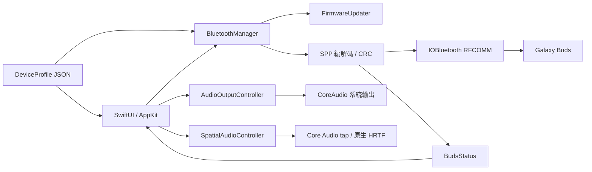
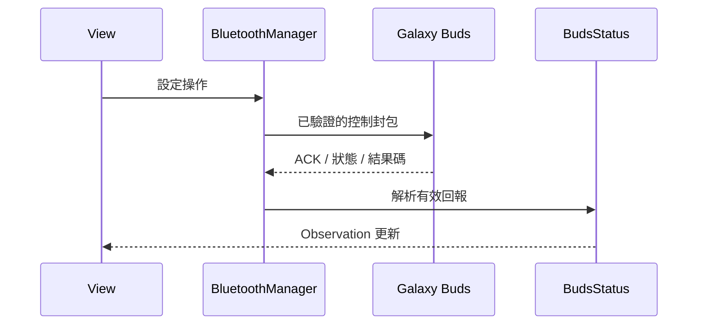

# Contributing

本文件說明 Galaxy Buds Mac Control 的開發、分層、測試、Pull Request、功能新增模式與發佈規則，開發前先閱讀 [AGENTS.md](AGENTS.md) 與 [DESIGN.md](DESIGN.md)。

<br>

## 開發環境

建議使用完整 Xcode 27、Python 3 與其隨附的 Swift 及 macOS SDK，系統框架由 SDK 提供。Package.swift 定義套件與部署目標。

開發入口共用 scripts/developer-environment.sh，優先採用 /Applications/Xcode.app 的工具鏈，保留 DEVELOPER_DIR 與 BUDS_SDK_PATH 覆寫。SDK 預設由 xcrun 取得。僅有 Command Line Tools 的環境可能缺少 SDK 27 所需要的 SwiftUI macro plugin，完整 UI 建置需要補齊 Xcode。App 原始碼保留標準 SwiftUI 寫法。核心測試直接使用 Swift 執行，適用於未安裝 XCTest 的工具鏈。

```bash
bash test.sh
bash build.sh
open "dist/Galaxy Buds Mac Control.app"
```

<br>

## App 建置與封裝

公開下載的套件依版本與 CPU 架構命名，發行說明標示實際簽章方式。ad-hoc 簽章可用於未公證版本，首次啟動流程請參閱 README。Developer ID 發行由發佈者管理憑證與帳號，並完成 notarization、stapling 與驗證。ad-hoc 簽章隨二進位內容變動，macOS 可能要求重新允許藍牙或音訊權限，權限由系統管理。

build.sh 以 Swift Package Manager 編譯，使用 Apple actool 將 AppIcon.icon 產生 Assets.car、供舊系統使用的 ICNS 及圖示 metadata，再複製配置、翻譯及素材，產生 dist/Galaxy Buds Mac Control.app，並執行本機 ad-hoc 簽章與驗證。簽章預設為 ad-hoc，BUDS_SIGN_IDENTITY 可指定本機鑰匙圈的簽章身分，具名身分採用 hardened runtime 與 timestamp。Bundle ID 來自 Info.plist。本機與 GitHub Actions 共用 `package.sh` 建置及封裝，版本讀取自 App 的 Info.plist，DMG 名稱包含版本與實際 CPU 架構。封裝使用 Apple hdiutil，內容包含 App 與 Applications 捷徑，完成後驗證映像並產生 `.sha256` 檔。

```bash
bash package.sh
```

### ZIP 封裝

需要 ZIP 時可使用下列指令，ZIP 保留完整 App 目錄結構。

```bash
ditto -c -k --sequesterRsrc --keepParent "dist/Galaxy Buds Mac Control.app" "dist/Galaxy-Buds-Mac-Control-macOS.zip"
shasum -a 256 "dist/Galaxy-Buds-Mac-Control-macOS.zip"
```

<br>

## 技術棧

| 類別 | 技術 | 責任 |
|---|---|---|
| UI | SwiftUI、AppKit | 選單列、popover、視窗、側欄及原生表單 |
| 狀態 | Observation、MainActor | 耳機快照、偏好與 UI 更新 |
| 藍牙 | IOBluetooth、CoreBluetooth | Classic RFCOMM、服務探索、權限及電源事件 |
| 音訊 | CoreAudio、AVFAudio、simd | 預設輸出、音量、聲道比例、process tap、HRTF 與頭部方向 |
| 配置 | Codable、JSON | 機型能力、欄位差異、服務與素材 |
| 語系 | 原生 .lproj、Localizable.strings | 正體中文與英文 |
| 建置 | Swift Package Manager | 編譯、資源與系統框架 |
| 驗證 | Swift 核心測試、Python 資源檢查 | 協定、邊界、配置、翻譯與素材 |

<br>

## 架構

View 讀取服務狀態並送出操作。BluetoothManager 管理連線與耳機命令，BudsStatus 解析已通過封包驗證的回報；AudioOutputController 管理獨立的系統音量，SpatialAudioController 管理音訊擷取與 HRTF 生命週期，FirmwareUpdater 管理裝置驅動的韌體傳輸與安裝確認。機型差異由 DeviceProfile 載入。



<br>

## 預覽與驗證

### 介面預覽

預覽模式使用示範狀態，可指定機型、產品顏色與明暗外觀，藍牙與系統音量副作用維持停用。實機驗收前先結束預覽程序。

```bash
open "dist/Galaxy Buds Mac Control.app" --args --demo --preview-model buds3Pro --preview-color white --preview-dark -AppleLanguages '(zh-Hant)'
```

### 程式與資源檢查

核心測試與資源檢查可獨立執行。介面、音訊與耳機的實際行為依 CONTRIBUTING 的驗收流程確認。

```bash
bash test.sh
xcrun swift-format lint --strict --recursive Sources Tests Package.swift
bash -n build.sh package.sh test.sh scripts/developer-environment.sh
```

<br>

## 分支規範

Git 操作依使用者明確指示執行，分支用途如下。

| 分支 | 用途 |
|---|---|
| main | 可建置及可驗收的基準 |
| codex/feature-name | Agent 協作功能或修正 |
| feature/name | 維護者新增功能 |
| fix/name | 維護者錯誤修正 |
| refactor/name | 結構調整 |
| docs/name | 文件與規則 |

<br>

## Pull Request

PR 交付行為、文件與驗證證據，審查者可依描述重現實際操作。

1. 確認功能語意、機型與協定依據。
2. 依 DESIGN 使用既有原生元件與功能分類。
3. 同步正體中文與英文。
4. 執行核心測試、資源檢查、格式檢查與建置。
5. 驗收明暗、視窗啟用狀態、快速操作及螢幕邊界。
6. 記錄實機結果與未驗證項目。
7. 描述問題、行為、動機、測試與相容性。

<br>

## Commit 格式

採用 Conventional Commits，標題描述具體行為，內文說明原因、影響與驗證。

| 欄位 | 規則 |
|---|---|
| type | feat、fix、refactor、docs、test、style、perf、build、ci、chore |
| scope | app、bluetooth、audio、profile、ui、i18n、assets、docs |
| subject | 現在式、祈使語氣、結尾無句號 |
| body | 原因、使用者影響與必要技術依據 |
| footer | Issue 與 BREAKING CHANGE |

<br>

## 專案分層

| 位置 | 責任 |
|---|---|
| Sources/App/ | App 與系統視窗生命週期 |
| Sources/Bluetooth/ | 通道、封包、命令與回報協調 |
| Sources/Audio/ | 系統輸出、音量、音訊 tap、HRTF 與事件監聽 |
| Sources/Firmware/ | 韌體目錄、映像驗證、傳輸與重啟版本確認 |
| Sources/Models/ | 值型別狀態、協定列舉與配置 |
| Sources/Views/ | SwiftUI、原生操作元件與 AppKit 橋接 |
| Sources/Diagnostics/ | 本機診斷及匯出 |
| Sources/Resources/ | Info.plist、語系、機型配置及素材 |
| Tests/ | Foundation 核心行為與邊界測試 |
| scripts/ | 素材與資源檢查 |
| .ai/skills/ | 可攜的規則及參考文件 |

<br>

## 狀態變更流程

### 耳機設定與回報

耳機設定經服務非同步排入原生傳輸，寫入 buffer 由完成 callback 釋放，排入、傳送與耳機確認分別回報。資料從 RFCOMM、串流組框、CRC 驗證進入快照，再由 Observation 更新畫面。ANC 模式、強度與環境音音量依實機回報更新，其他候選值維持命令回饋，耳機 ACK 或狀態回報具有最終權威。



### 空間音訊與授權

系統空間音訊由 Core Audio process tap 與 AVAudioEnvironmentNode 管理。擷取資料經原生播放器渲染，頭部方向採用 simd 四元數轉換，分類切換共用視窗根層的音訊與感測器生命週期，停止、視窗關閉、輸出變更與 App 結束時釋放資源並還原耳機空間音訊旗標。授權由 macOS 管理，藍牙採用 CBManager.authorization 讀取，音訊擷取狀態與系統授權開關各自呈現。

### 系統音量

系統音量由 CoreAudio 管理。監聽在輸出裝置或聲道改變時更新，連續通知合併後讀取音量，保留左右聲道比例。App 結束時移除監聽與背景任務。

<br>

## 新增功能模式

1. 查詢既有實作、機型能力、手機畫面及協定依據。
2. 確認命令 ID、payload、ACK、狀態欄位與有效範圍。
3. 差異放入機型配置，共用協定使用既有型別與解析流程。
4. 先處理輸入、未知值、短資料與傳輸失敗，再串接 UI。
5. 將設定放在對應功能頁，快捷控制共用相同服務操作。
6. 同步翻譯、測試、文件及素材來源。
7. 在兩款耳機驗收，記錄結果。

<br>

## 參考專案的 macOS 發版

封裝、Developer ID 簽章及 Apple 公證各自驗證。兩個參考專案提供可用的封裝範例，公開流程未提供可直接沿用的 Developer ID 與 notarization 設定。

本專案的原生 Swift App 可採用 App／ZIP 或 DMG，依 release tag 執行驗證及產物上傳。正式簽章與公證需要有效 Developer ID 和相應發行設定，產生 ZIP、DMG 或 PKG 本身不代表完成公證。

| 專案 | 公開建置與封裝 | 簽章證據 |
|---|---|---|
| galaxy-buds-mac | [build.sh](https://github.com/vedatkilic/galaxy-buds-mac/blob/3ffedf8217695075188ac4a6b1d0664022f58d92/build.sh) 建置 arm64 App，[package.sh](https://github.com/vedatkilic/galaxy-buds-mac/blob/3ffedf8217695075188ac4a6b1d0664022f58d92/package.sh) 產生拖入 Applications 的 DMG | 使用 ad-hoc；[v1.4.0](https://github.com/vedatkilic/galaxy-buds-mac/releases/tag/v1.4.0) 說明未正式簽章 |
| GalaxyBudsClient | [macOS workflow](https://github.com/timschneeb/GalaxyBudsClient/blob/754b6fdfb1c151b022cece775c8aaad4eb185afa/.github/workflows/compile-macos.yml) 建置 arm64、x64、universal PKG，Release 事件附加產物 | [5.2.1](https://github.com/timschneeb/GalaxyBudsClient/releases/tag/5.2.1) 明確說明沒有 Apple Developer ID 憑證 |

<br>

## Swift 與註解

資料與解析以 struct、enum 及純轉換為主，具有系統 callback、資源生命週期或共享可觀察狀態的服務使用 class。業務責任以組合實作，AppKit delegate 依框架要求使用 NSObject。

依 [原生程式規則](.ai/skills/rule-native/SKILL.md) 與 [註解規範](.ai/skills/rule-native/references/commenting.md) 維持宣告順序、資料流、單位、副作用、取消與失敗邊界。註解以正體中文描述終態行為，型別與方法說明各自責任。

<br>

## 測試契約

韌體查詢分開呈現耳機目前版本、Samsung 官方資訊與第三方封存來源。封存站的最新版本代表其已收集資料，下載與安裝資格分別判讀。前綴比對是版本系列的保守檢查，Buds 的 XX 欄位不能直接當成使用者所在地區。

硬體測試另記錄型號、韌體、操作、實際回報及聽感。睡眠、喚醒、手機接走連線、重連、快速音量變更及多次開關面板屬於執行期驗收。

核心測試驗證配置、CRC、分段組框、損毀資料、未知事件、ACK、狀態欄位、韌體映像與傳輸失敗、版本比較及 PCM 聲道布局。資源檢查驗證語系、配置動態文字、權限文案、技能入口、素材雜湊及可見矩形。

```bash
bash -n build.sh package.sh test.sh scripts/developer-environment.sh
xcrun swift-format lint --strict --recursive Sources Tests Package.swift
bash test.sh
bash build.sh
```

<br>

## 原生樣式與元件

詳細設定使用 NavigationSplitView 與 Form.grouped，操作元件使用 Button、Toggle、Picker、Slider、LabeledContent 與 NSSlider。NSPopover 顯示快捷面板。模式圓、ANC 與產品圖片共用既有元件，視覺規則請參閱 DESIGN。

<br>

## 產品素材

完整下載 URL、產品頁與 SHA-256 位於 Sources/Resources/Products/sources.json。每個顏色提供耳機與充電盒 PNG，原檔保留透明內容，畫面依配置的可見矩形裁切顯示。

下載內容變動時雜湊驗證會停止，維護者需要重新確認來源、素材及使用條件。

```bash
python3 scripts/product-assets.py
python3 scripts/product-assets.py --download
```

<br>

## i18n

正體中文與英文分別位於 zh-Hant.lproj 與 en.lproj。新增可見文字同步維護兩個 Localizable.strings，權限文案保存在 InfoPlist.strings，機型動態標籤同樣需要翻譯。

<br>

## 機型配置

支援機型由配置載入，配置隨 App 打包並在啟動時驗證，包含模型識別、能力、服務 UUID、ANC 段數、環境音上限、配色、圖片矩形、進階狀態 offset 與充電盒欄位長度。相同協定的新機型可新增配置，格式差異須有對應解析與測試。

配置來自耳機協定，執行時依機型與回報判斷能力。實測手機的型號、作業系統版本及裝置位址記錄於本機研究證據。

<br>

## 藍牙協定

SPP 採用 modern 組框、10-bit 長度與 CRC-16/CCITT。未知合法事件整包略過，短資料、未知列舉及未回報值依既有狀態語意處理。取消與重試使用連線世代排除過期 callback。

通道建立成功表示 RFCOMM 開啟，Mac 音訊仍由系統管理。未知自訂名稱可指定機型，裝置清單依標準化位址排除重複資料，保留不同實體裝置。

<br>

## 版本與發行

[來源 Info.plist](Sources/Resources/Info.plist) 是版本唯一來源，`CFBundleShortVersionString` 使用 `X.Y.Z`，`CFBundleVersion` 使用遞增正整數。壓版由維護者修改這兩個欄位並提交，tag 標記已壓版的 commit。`build.sh` 複製來源版本，`package.sh` 讀取產物版本，pipeline 驗證 tag 與版本一致。

### 壓版與發行準備

發行前確認下列事項，Git 與公開發佈操作依使用者明確指示執行。

1. 確認 README 支援範圍與兩款耳機的實機驗收記錄。
2. 確認 Samsung 圖片的公開重製條件。
3. 在來源 Info.plist 設定發行版本及建置編號。
4. 執行必要檢查與 `bash package.sh`，確認 CPU 架構、部署目標、版本、資源與 DMG 內容。
5. 確認簽章方式。預設 ad-hoc 版本說明首次啟動提示；Developer ID 版本另行完成 notarization、stapling 與驗證。
6. 提交已壓版的原始碼，以 `vX.Y.Z` 標記該 commit，推送 tag 觸發發行。
7. 從 Release 下載產物，驗證安裝、權限、啟動、連線、設定、替換更新與結束。

### GitHub Actions

[release.yml](.github/workflows/release.yml) 由推送 `v*` tag 觸發，在 macOS runner 執行檢查與測試，再呼叫 `package.sh`。標籤透過 `BUDS_RELEASE_TAG` 傳入建置入口，只用來檢查來源版本，例如 `v0.1.0` 必須對應 `0.1.0`，不一致時停止建置。建置編號直接讀取來源，pipeline 執行次數不影響 App 版本。

DMG 與 SHA-256 檔隨 GitHub Release 上傳，Release 使用標籤與自動產生的說明。workflow 使用 GitHub 提供的 token，簽章預設為 ad-hoc。Developer ID 與公證需要發佈者另外設定。workflow 的本機腳本可獨立驗證，雲端發行結果以實際 Actions 執行記錄為準。

<br>

## 發行說明

發行說明依使用者行為分組，列出新增功能、修正、相容性、已知限制與下載需求。標示實際驗收的機型與韌體，建置成功與硬體驗證各自提供證據。

<br>

## 疑難排解

診斷可能包含裝置識別及序號，匯出與分享前檢查內容。系統日誌使用 private 欄位，本機研究產物位於 .build，排除於版本控制。

| 現象 | 檢查方向 |
|---|---|
| SwiftUI macro plugin 缺失 | 使用完整 Xcode 工具鏈，或以 BUDS_SDK_PATH 指定可用 SDK |
| 控制通道無法開啟 | 確認 Mac 已連接耳機、結束同時使用控制通道的管理 App、檢查 SDP 與逾時紀錄 |
| 耳機名稱重複 | 核對裝置位址與配對清單的重複資料排除方式 |
| 盒子電量未回報 | 對照耳機放入充電盒、盒蓋開啟與耳機回報的時機 |
| 音訊擷取未收到資料 | 檢查「隱私權與安全性 → 螢幕與系統錄音 → 僅限系統錄音」，重新啟動 App，核對目前簽章與授權 |
| 音量不可調整 | 檢查目前輸出裝置是否提供可調整的音量 |
| 操作未確認 | 區分傳輸結果、ACK、狀態回報與實際行為 |
| 彈窗裁切 | 檢查所在螢幕、錨點、可見高度與固定 viewport |
